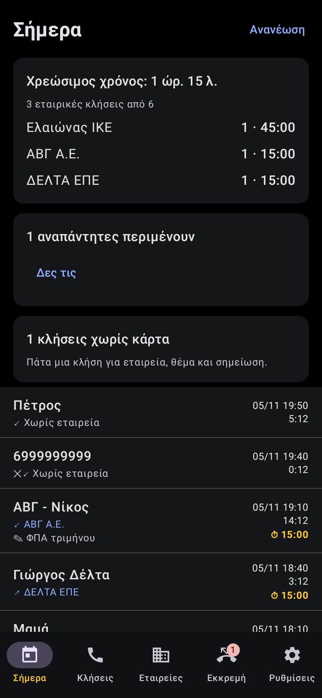
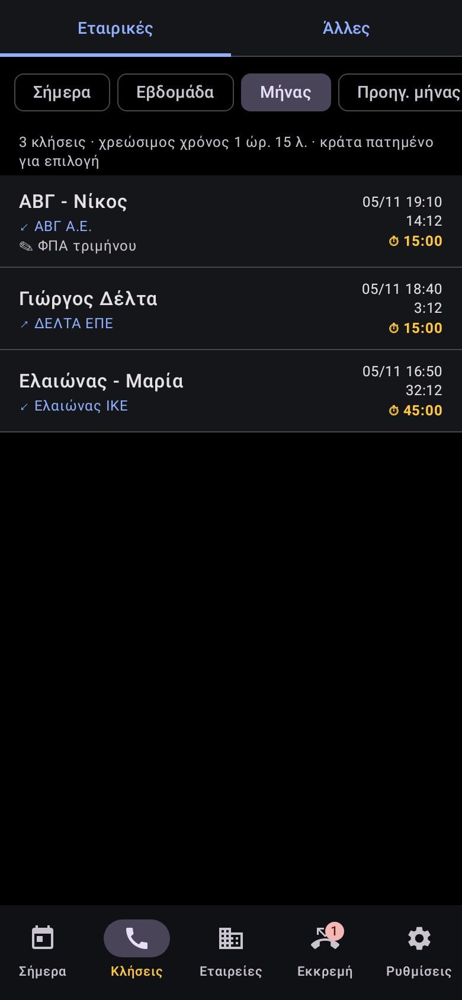
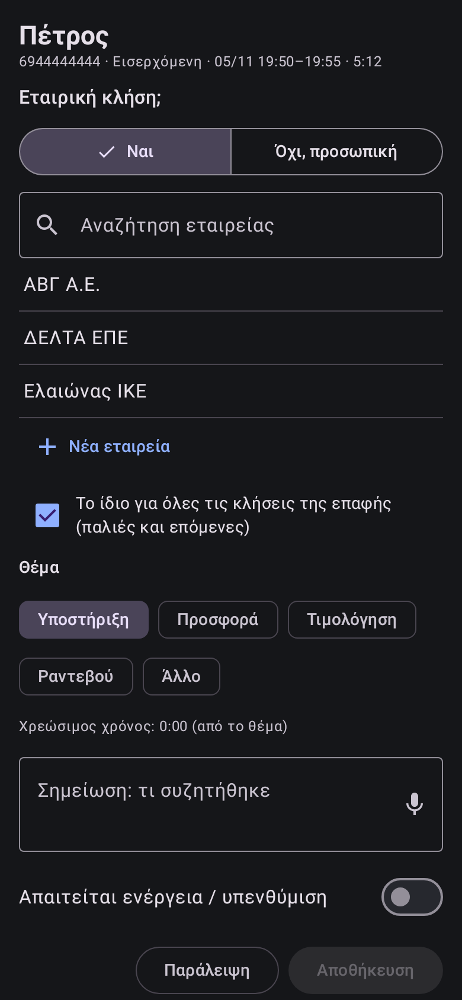
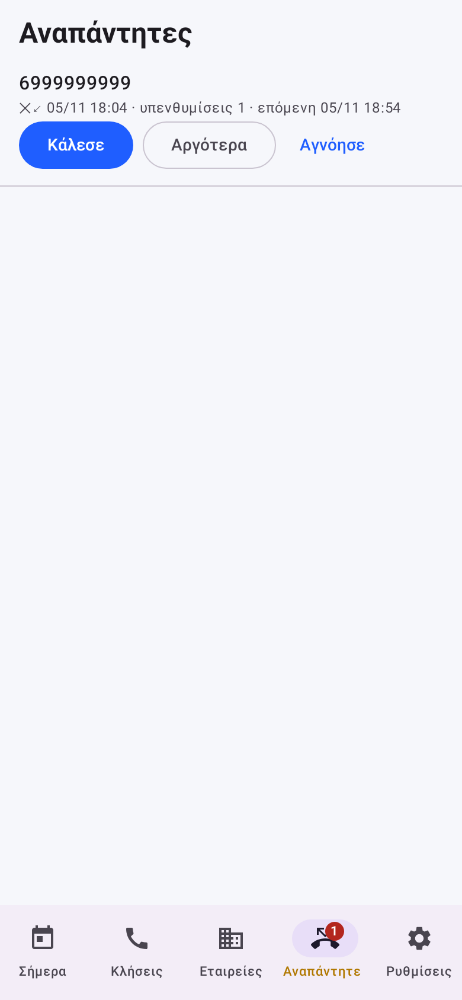

<p align="center"></p>

<h1 align="center">Billable Calls</h1>

<p align="center"><b>Οι κλήσεις με τους πελάτες σου, ανά εταιρεία, σε χρεώσιμο χρόνο.</b><br>
Όλα μένουν στο κινητό σου. Χωρίς server, χωρίς λογαριασμό, χωρίς διαφημίσεις.</p>

<p align="center">
  <a href="https://github.com/jemangr/Billable-Calls/releases/latest/download/BillableCalls.apk"></a>
</p>

<p align="center">Android 10+ · δύο SIM · ελληνικά και English · ανοιχτός κώδικας (MIT) · αυτόματες ενημερώσεις · <a href="https://platebit.app/bill">platebit.app/bill</a></p>

<p align="center">




</p>

*[English below](#english)*

## Τι κάνει

- **Βρίσκει την εταιρεία κάθε κλήσης:** από το πεδίο «Εταιρεία» της επαφής, ή από το όνομα (η εταιρεία πριν ή μετά το όνομα του υπαλλήλου, με όποιο διαχωριστικό). Αυτόματα μόνο όταν είναι σίγουρο.
- **Καταγράφει** έναρξη, λήξη και διάρκεια. **Χρεώσιμος χρόνος** με ελάχιστη διάρκεια (1′, 5′, 10′, 15′ ή δική σου) και στρογγύλεμα προς τα πάνω, και ανά εταιρεία.
- **Κάρτα στο τέλος κάθε κλήσης:** εταιρική ή όχι, ποια εταιρεία, θέμα και σημείωση.
- **Λίστες «Εταιρικές» και «Άλλες»** με πρώτη στήλη το όνομα της επαφής. Μετακινείς κλήσεις από τη μία στην άλλη με ένα πάτημα.
- **Υπενθυμίσεις** για αναπάντητες και για εξερχόμενες χωρίς απάντηση, στο δικό σου ωράριο (Δευ–Παρ, Σάββατο, Κυριακή, ώρες χωρίς υπενθυμίσεις). Σταματούν όταν μιλήσετε, μετά από Ν φορές, μετά από χρόνο ή με το «Αγνόησε», ό,τι έρθει πρώτο.
- **Export** σε Excel, CSV ή PDF, ανά εταιρεία ή για όλες, με κοινοποίηση ή κατευθείαν στο Google Drive.
- **Λίστα πελατών** από αρχείο CSV/Excel, από link ή από Google Drive. **Backup** κάθε μέρα στο Google Drive ή σε αρχείο.

<a id="english"></a>

## English

Billable Calls reads your phone's call log and turns calls with customers into billable time per company.

- **Finds the company of every call:** from the contact's Company field, or from the contact name (company before or after the person's name, any separator). Automatic only when it is sure.
- **Logs** start, end and duration. **Billable time** with a minimum length (1′, 5′, 10′, 15′ or your own) and rounding up, per company if you like.
- **A card at the end of each call:** is it a business call, which company, topic and a note.
- **Lists of business calls and other calls**, with the contact name first. Move calls between them in one tap.
- **Reminders** for missed calls and unanswered outgoing calls, on your own schedule (weekdays, Saturday, Sunday, quiet hours). They stop when you talk, after N reminders, after a set time or when you dismiss them, whichever comes first.
- **Two SIMs:** choose which one counts.
- **Export** to Excel, CSV or PDF, per company or for everyone, by share or straight to Google Drive.
- **Customer list** from a CSV/XLSX file, a link or Google Drive. **Daily backup** to Google Drive or to a file.
- Greek and English. Automatic updates from GitHub releases.

**Everything stays on your phone.** No server, no ads, no tracking. See [PRIVACY.md](PRIVACY.md).

## Customer list

The list can be a CSV or an Excel file:
- **Column A:** the company name.
- **Next columns:** aliases (trade name, short name). You can also put several aliases in one cell, separated by `|`.
- A first row of titles («Επωνυμία», «Name»…) is skipped.

Legal forms (ΑΕ, ΕΠΕ, ΙΚΕ, ΟΕ, ΕΕ, LTD…), accents and dots don't count when names are compared.

## Why not on Google Play

Google Play allows the call-log permission only after a special declaration, and approval is not certain. The app is published here, with automatic updates from the releases.

## Building

```
./gradlew :app:testDebugUnitTest :app:assembleRelease
```
- **Releases:** a new `versionName` in `app/build.gradle.kts` on `main` builds and publishes a release.
- **Signing:** releases need the repository secrets `RELEASE_KEYSTORE` (base64 of the .jks), `RELEASE_STORE_PASSWORD`, `RELEASE_KEY_ALIAS` and `RELEASE_KEY_PASSWORD`.
- **Google Drive:** see [docs/GOOGLE-DRIVE.md](docs/GOOGLE-DRIVE.md).

## License

MIT, © 2026 jemangr.
