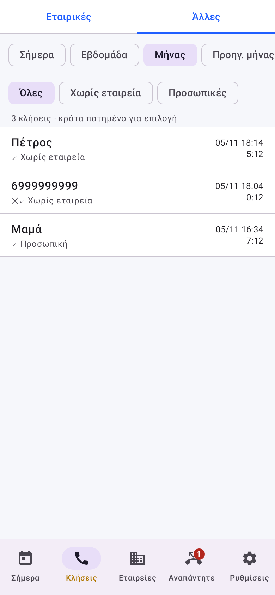
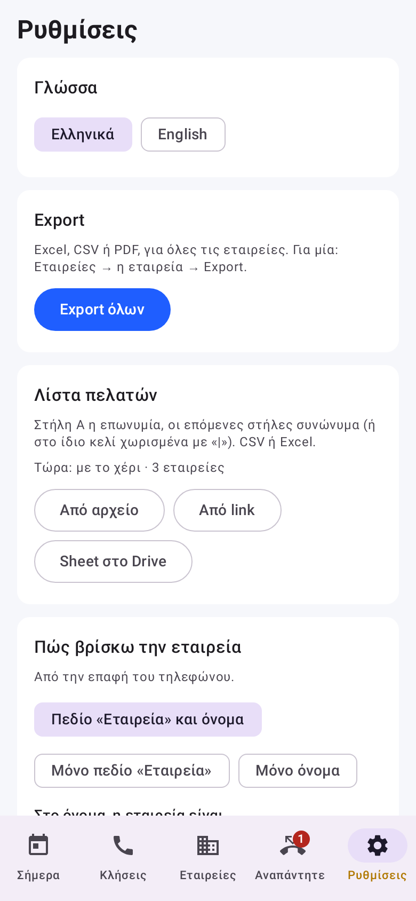

# Billable Calls

[](https://github.com/jemangr/Billable-Calls/actions/workflows/build.yml)

**[⬇ Download the APK](https://github.com/jemangr/Billable-Calls/releases/latest/download/BillableCalls.apk)** · Android 10 or newer

Billable Calls reads your phone's call log and turns calls with customers into billable time per company.

- **Finds the company of every call:** from the contact's Company field, or from the contact name (company before or after the person's name, any separator). Automatic only when it is sure.
- **Logs** start, end and duration. **Billable time** with a minimum length (1′, 5′, 10′, 15′ or your own) and rounding up, per company if you like.
- **A card at the end of each call:** is it a business call, which company, topic and a note.
- **Lists of business calls and other calls**, with the contact name first. Move calls between them in one tap.
- **Reminders** for missed calls and unanswered outgoing calls, on your own schedule (weekdays, Saturday, Sunday, quiet hours). They stop when you talk, after N reminders, after a set time or when you dismiss them, whichever comes first.
- **Two SIMs:** choose which one counts.
- **Export** to Excel, CSV or PDF, per company or for everyone, by share or straight to Google Drive.
- **Customer list** from a CSV/XLSX file, a link or Google Drive. **Daily backup** to Google Drive or to a file.
- Greek and English. Automatic updates from GitHub releases.

**Everything stays on your phone.** No server, no ads, no tracking. See [PRIVACY.md](PRIVACY.md).

| Today | Business calls | Other calls |
|---|---|---|
|  |  |  |
| **After-call card** | **Missed calls** | **Settings** |
|  |  |  |

## Customer list

The list can be a CSV or an Excel file:
- **Column A:** the company name.
- **Next columns:** aliases (trade name, short name). You can also put several aliases in one cell, separated by `|`.
- A first row of titles («Επωνυμία», «Name»…) is skipped.

Legal forms (ΑΕ, ΕΠΕ, ΙΚΕ, ΟΕ, ΕΕ, LTD…), accents and dots don't count when names are compared.

## Why not on Google Play

Google Play allows the call-log permission only after a special declaration, and approval is not certain. The app is published here, with automatic updates from the releases.

## Building

```
./gradlew :app:testDebugUnitTest :app:assembleRelease
```
- **Releases:** a new `versionName` in `app/build.gradle.kts` on `main` builds and publishes a release.
- **Signing:** releases need the repository secrets `RELEASE_KEYSTORE` (base64 of the .jks), `RELEASE_STORE_PASSWORD`, `RELEASE_KEY_ALIAS` and `RELEASE_KEY_PASSWORD`.
- **Google Drive:** see [docs/GOOGLE-DRIVE.md](docs/GOOGLE-DRIVE.md).

## License

MIT, © 2026 jemangr.
